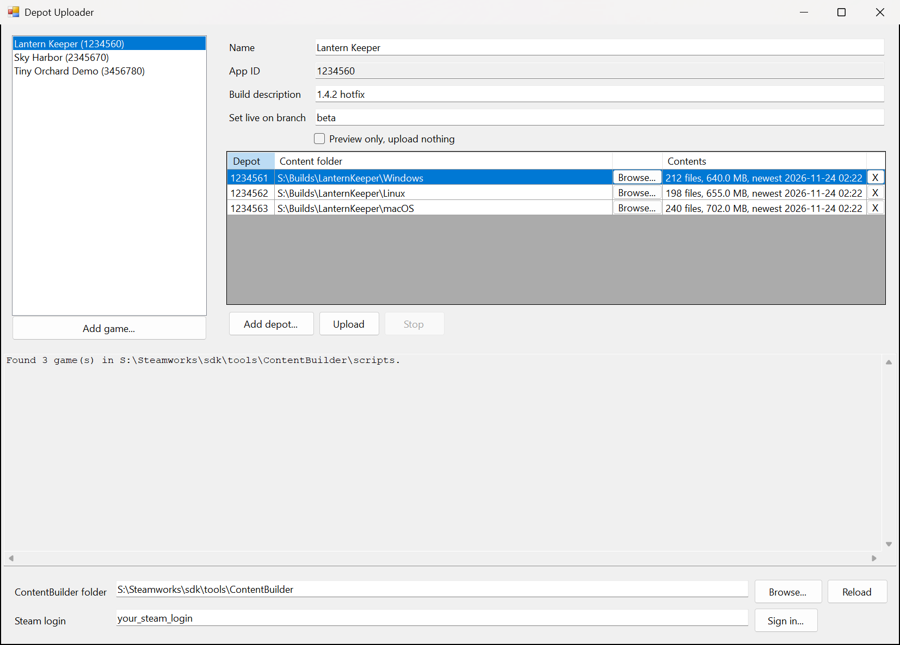

# Depot Uploader

A Windows tool that uploads game builds to Steam with `steamcmd` and keeps all your games in one window.



Valve's SteamPipe GUI handles one game per window. Depot Uploader lists every game that has an `app_<appid>.vdf` script in the Steamworks SDK's `ContentBuilder\scripts` folder. Games set up with SteamPipe GUI appear in the list, and both tools can edit the same scripts.

## Download

Download `DepotUploader-<version>-win-x64.exe` from the [latest release](https://github.com/tarragonfly/DepotUploader/releases/latest). It's a single 166 KB exe.

Requirements:

- Windows 10 version 1903 or later, or Windows 11. The exe is framework-dependent and requires .NET Framework 4.8, which these versions include.
- The Steamworks SDK, for `sdk\tools\ContentBuilder`.

The exe is not code-signed. Windows SmartScreen may show a warning on first run.

## Use

1. At the bottom of the window, choose the `ContentBuilder` folder and enter your Steam login name.
2. Click **Sign in** once. steamcmd opens in its own window and asks for your password and Steam Guard code there. steamcmd saves the sign-in for later uploads.
3. Select a game, set the build description and the content folder of each depot, then click **Upload**.

To upload several games, tick them in the game list and click **Upload ticked games**. steamcmd runs once per ticked game, in list order. A game that fails doesn't end the batch.

**Add game** writes a new `app_<appid>.vdf` and one `depot_<depotid>.vdf` per depot. **Add depot** adds a depot to the selected game. The trash button in a depot row removes the depot from the game and keeps its `depot_<depotid>.vdf`. A warning icon marks a depot whose content folder is not set, not found, empty or unreadable.

**Remove game** moves the selected game's `app_<appid>.vdf` and its depot scripts to `scripts\removed`. A depot script that another script in `scripts` refers to is not moved. To list the game again, move the files back and click **Reload**.

| Field | Script key | Effect |
|---|---|---|
| Build description | `desc` | The label of the build in Steamworks |
| Set live on branch | `setlive` | The branch that gets the build after the upload. Leave it empty to set the build live in Steamworks yourself. |
| Preview only, upload nothing | `preview` | steamcmd builds the depot manifests and uploads nothing |
| Content folder | `contentroot` in the depot script | The build folder that goes into the depot. Leave it empty to use `contentroot` of the app script. |

There is no Save button. An edit is saved when you leave its field. **Upload** shows the file count, total size and absolute path of each content folder and asks you to confirm. The files are counted again right before steamcmd starts, and a game whose content folder changed since the confirmation is not uploaded. The log shows steamcmd's output while it runs, then its exit code and the app build log.

## Limits

- The tool never asks for, stores or passes a password. When an upload stops at the login, click **Sign in** and upload again.
- Each depot needs its own script file. Depots written inside the app script are not supported.
- The second file count compares the path, size and write time of every file in a content folder, including files the depot's `FileMapping` and `FileExclusion` leave out. File contents are not hashed.
- Values can't contain a double quote.
- Comments in a script are removed when the tool saves it.
- A save fails when a script changed on disk after the tool loaded it. Click **Reload** to read the scripts again. **Reload** discards unsaved edits.
- When a failed save can't restore a file, the error names the `.previous` file that holds it. Rename that file to the original name.
- Game names, the sort order, the ContentBuilder path and the Steam login name are saved in `%APPDATA%\DepotUploader\settings.json`. With two windows open, the last write wins.
- Dark mode is on at startup, and the **Dark mode** check box is not saved. Windows draws the message boxes and the folder picker in its own colors. The title bar has the window color on Windows 11 only.
- With Windows high contrast on, the controls have the look and the colors of Windows and there is no **Dark mode** check box. The high contrast setting is read at startup. Restart Depot Uploader after you turn it on or off.

## Build from source

Requires the .NET 10 SDK.

```
dotnet publish src/DepotUploader -c Release -o publish
```

## License

MIT, see [LICENSE](LICENSE).

Depot Uploader is not affiliated with Valve. This repository contains no Valve software. You need your own copy of the Steamworks SDK. Steam, Steamworks and SteamPipe are trademarks of Valve Corporation.
